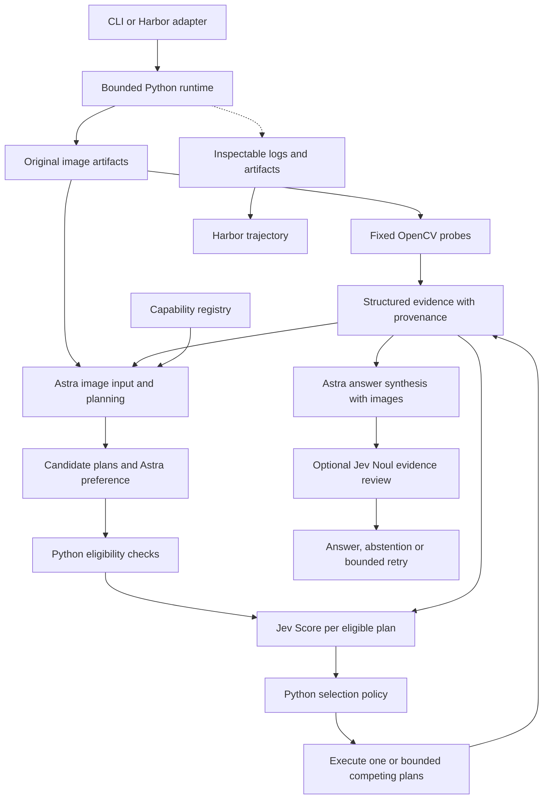

# Architecture and policy

This page documents the historical typed-tool POC. The clarified target is the
[research-to-execution architecture](research-execution-harness.md), which connects
discovery, documentation, candidate and plan scoring, Codex execution, and review.
The [v3 implementation guide](research-execution-v3.md) maps the connected runtime,
structured stage packets and isolated benchmark adapter. Its live validation is
separate from the historical v1/v2 implementations described below.

The runtime uses a typed plan protocol rather than unrestricted code generation. A tool step contains a registered tool name, validated arguments and a reference to the original image or an earlier image-producing step in the same plan. Astra can chain crop and segmentation operations. Each returned artifact preserves its coordinate system.

The fixed probes do not depend on Astra's choice. They expose measured color coverage, threshold sensitivity, contrast and a sharpness diagnostic. They do not establish object identity. Jev receives these observations, supplied capability descriptions and clearly labeled unverified Astra observations. Its current text input cannot independently verify the image.

The source image is decoded with OpenCV to a consistent BGR array for processing and stored as a PNG. Astra receives that PNG through image input, not a string of RGB values. Jev receives structured measurements. No fake visual encoder or universal confidence field is introduced.

## Selection and review

Hard requirements are code: registered operation, argument ranges, valid dependencies, supported coordinates and bounded steps. A high model score cannot override these.

Jev gives every eligible candidate a score using the same four descriptive levels. Python ranks candidates; close scores or low confidence can cause at most two competing methods to run. If no method qualifies, Astra can revise within the round budget. If the only candidate is uncertain, the runtime abstains or replans rather than silently accepting it.

The initial development threshold of 2.0 rejected two plausible read-only methods with scores around 1.95–1.97 because their assumptions still needed evidence. The current development threshold is 1.5 to permit bounded empirical trials of such methods. This is a documented development adjustment, not calibrated evidence of reliability. The original run remains in `runs/live-smoke/`. Neither threshold should be interpreted as an accuracy percentage.

After tools run, Astra receives their immutable measurements plus original/derived images. Jev's optional Noul review assesses whether the supplied evidence supports the candidate answer. A rejected review triggers another bounded round, then abstention if unresolved. Unknown evidence IDs are rejected in code. Semantic correctness still requires the independent benchmark or a human reviewer.

## Resource limits and failures

Default limits are two rounds, three candidates, up to three steps per plan, and at most two selected competing plans per round. Each hosted request has a timeout and output-token limit. OpenAI automatic SDK retries are disabled so retries are visible rather than silently increasing spend. There is no exact dollar-budget enforcement in v1.

Tool validation failures are recorded and can inform a later plan. Provider errors and malformed outputs produce an error answer and saved trace; they are not silently replaced with offline results. Offline mode must be explicitly requested. A model abstention is a normal experimental outcome, not a transport success masquerading as correctness.

## Replacing components

Provider interfaces live in `contracts.py`. A provider implements planning/answering or assessment/review; the runtime does not depend on its HTTP response format. New tools need an implementation, schema, registry entry, and tests against known outputs. New modalities need appropriate decoding and output conventions; DICOM/fMRI require more than allowing another file extension.

The core package imports Harbor only when an evaluation/export command is invoked. Local tool debugging therefore remains independent of evaluation infrastructure. For now, configuration and prompts are project files; run from the repository root or the task bundle's `/app` directory.

## Sources checked during implementation

- [OpenAI model guidance](https://developers.openai.com/api/docs/guides/latest-model) and [structured outputs](https://developers.openai.com/api/docs/guides/structured-outputs).
- [TypeSafe HTTP API](https://docs.typesafe.ai/api), [Score](https://docs.typesafe.ai/primitives/score), and [supported state](https://docs.typesafe.ai/concepts/state).
- [Harbor custom agents](https://docs.harborframework.com/core-concepts/agents/custom-agents), [tasks](https://docs.harborframework.com/core-concepts/tasks/overview), and [ATIF](https://docs.harborframework.com/core-concepts/agents/atif).

The installed Harbor 0.23.0 source was also inspected, and its actual Pydantic schemas validate our tasks and trajectories. Documentation and package releases can differ; the lockfile is the reproducibility reference for this repository.
