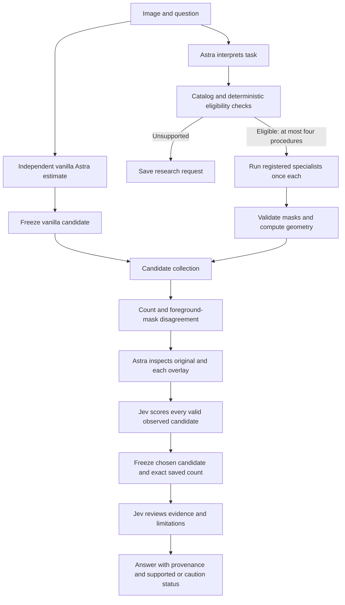

# Select among observed outputs

This remains a narrower experiment. The
[clarified target architecture](research-execution-harness.md) connects research,
usage documentation, model and plan scoring, agent execution and replanning; it
has not yet been implemented or benchmarked end to end.

Status: implemented experimental v2 path; 87 local tests pass and one real
development-image integration run completed. There is no new capability result
yet. See the [smoke verification](../reports/observed-routing-smoke-20260922/README.md).
The completed
[37-image, three-run evaluation](../reports/kromp-repeated-20260922/findings.md)
showed weak routing: Jev chose a lowest-error available procedure on 20/111
trials. Vanilla achieved 70.3% within-10% success versus the current harness's
58.6% after the [reference repair](../reports/stardist-audit-20260922/index.html), counting abstentions as failures. The earlier 55.9% figure is superseded. Specialist benefits varied by image.

V2 tests a specific hypothesis: giving selection actual outputs, a visual
comparison and an independent vanilla candidate may help it avoid bad tool use.
This hypothesis is not established by implementing it.



The vanilla request receives only the original image, question and ordinary
vanilla instructions, before any specialist inference. It cannot see later
counts or Jev scores. Its stored count becomes an explicit selectable candidate;
it is not a silent fallback after another component fails.

The four registered procedures are three StarDist parameter profiles and
Cellpose-SAM. StarDist profiles share weights and are not independent votes.
V2 executes all eligible procedures before selecting an answer, unlike v1's
pre-execution selection. This is deliberately a more expensive experiment.
It refuses a catalog above the four-procedure limit instead of silently omitting
candidates. Budgeted tool acquisition is a separate future experiment.

## File map

| File | Responsibility |
|---|---|
| `src/vision_harness/evidence_routing/contracts.py` | Candidate values, provenance and attributed visual observations. |
| `src/vision_harness/evidence_routing/measurements.py` | Independent artifact/count checks, area distributions and label-free disagreement. |
| `src/vision_harness/evidence_routing/runtime.py` | Fixed bounded workflow; provider errors, candidate failures and frozen decisions. |
| `src/vision_harness/routing/cli.py` | Exposes `vision specialist compare`; existing `run` behavior remains available. |
| `configs/evidence-routing.toml` | Astra/Jev settings for observed-output selection. |
| `configs/poc-adaptive.toml` | Separate existing instructions for the independent vanilla call. |
| `prompts/astra-evidence-routing.md` | Task interpretation and image-based candidate observations. |
| `prompts/jev_observed_candidates.json` | Selection rubric for actual outputs, including the visual-only candidate. |
| `prompts/jev_observed_review.json` | Review of selected output support, with explicit limits. |
| `tests/test_evidence_routing.py` | Independence, grounding, failed-candidate handling, scoring completeness and trace checks. |

## Evidence and decision rules

Local code reopens each predicted instance map, verifies its checksum and input
hash, checks original geometry and recounts distinct positive labels. It derives
foreground fraction, border count, area quantiles and foreground/background mean
intensity directly from the image and mask. These describe the output; none is a
calibrated quality score or proof of biological correctness.

Pairwise count differences use a symmetric normalization by the larger count
(zero for two zero counts). Foreground IoU compares occupied pixels and cannot
detect every split/merge. Two empty masks have undefined foreground IoU, recorded
as null. Agreement among models can reflect a shared mistake. No reference mask,
benchmark count, test-class label or past accuracy table enters the router.

Astra sees the original and labeled overlays and returns observations for every
valid candidate exactly once. It cannot invent, edit or silently omit counts.
Jev gets the measurements and clearly attributed Astra observations; it still
does not receive image pixels. Jev scores every valid numeric candidate,
including vanilla. Candidate execution errors and abstentions are preserved
separately and cannot win selection.

Selection is descending Jev Score with stable candidate-ID ties. It copies the
selected frozen count without averaging predictions or asking a language model
to rewrite it. A visual-only answer is explicitly labeled an estimate with no
instance map; a specialist answer links to its actual mask. All limitations and
inspection concerns are retained. Review below 0.75 adds `caution`, preserving
the existing provisional-estimate policy. Review does not calibrate the answer
or trigger an unbounded loop. A provider failure remains a visible error; it
does not silently substitute an available candidate for a completed harness run.

The run saves `vanilla-answer.json`, `intent.json`, `eligibility.json`, per-tool
artifacts, `candidate-errors.json`, `candidates.json`, `disagreement.json`,
`inspection.json`, `decision.json`, `candidate-answer.json`, `review.json`,
`answer.json`, provider exchanges and an optional Harbor ATIF trace. Input,
source, catalog and prompt hashes identify the experiment. Large masks stay on
disk; providers receive bounded measurements and actual image inputs where
supported.

There are five base hosted calls: vanilla Astra, Astra task interpretation, Astra
visual inspection, Jev candidate scoring and Jev review. Existing bounded Astra
format/output-budget retries can add calls. Each eligible specialist runs once;
failed candidates are recorded, never retried by this workflow.

## Run without this chat

From the repository root, enter credentials yourself in the Git-ignored `.env`:

```dotenv
OPENAI_API_KEY=your_key
JEV_API_KEY=your_key
```

```bash
.venv/bin/vision specialist compare \
  --image /absolute/path/to/image.png \
  --prompt 'Estimate the number of nuclei in this fluorescence image.' \
  --output runs/my-observed-output-test
```

This makes billed Astra/Jev requests and runs local specialist workers. It reads
the key locally and never needs the value pasted into a chat. The provider adapter
constructs each request from the supplied task, images and explicit stage data;
it does not send this Codex conversation. Running directly in your terminal
requires no ongoing assistant turn. API calls still use their own input/output
tokens and context limits. OpenAI documents how request state is supplied in its
[conversation-state guide](https://developers.openai.com/api/docs/guides/conversation-state).

Inspect a completed run without making API calls:

```bash
.venv/bin/vision inspect runs/my-observed-output-test
.venv/bin/vision replay runs/my-observed-output-test
```

`inspect` shows configuration and the final result; `replay` prints the recorded
events. Neither reruns the experiment.

This path currently supports the same 2D fluorescence nucleus-counting inputs as
v1, with an explicit requirement for 8-bit grayscale or three-channel raster
inputs. Higher-bit-depth microscopy needs a recorded conversion before this
command; it is rejected instead of silently losing scientific intensity data.
It does not add DICOM, fMRI, video, new model adapters, learned calibration,
automatic model installation or a production scheduler.

## Evaluate the hypothesis

Use previously seen images for development and integration smoke checks only.
Freeze policy, prompts, versions and a new external cohort before evaluating
accuracy. Repeat each task at least three times; retain all failures and
abstentions. Report conditional count error with coverage, all-attempt success,
mask F1, latency and provider usage. Bootstrap over images, not repeated calls.

Compare vanilla, each fixed procedure, v1, and v2. V2 stage ablations should share
exact saved candidates to isolate the selector; independently replanned pipelines
answer a different question. Report whether Jev ranks better from measurements
alone versus measurements plus attributed Astra observations. Review quality
requires correctness/coverage analysis on separate data, not a higher Noul value.
Do not tune on the completed Kromp test and call a rerun new held-out evidence.

The historical frozen source checksum refers to the source at commit `5381ddb`
(inference source was unchanged from the earlier run commits). New v2 modules
change the current source-tree checksum. Reproduce historical source audits in
that revision; preserve its protocol and saved predictions.
