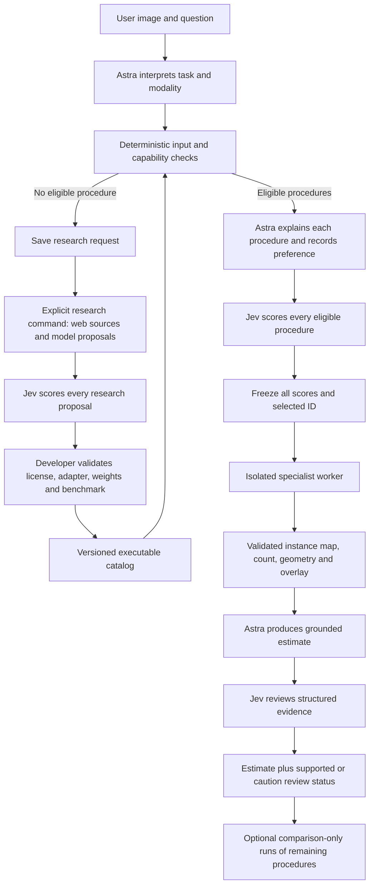

# Specialist routing: file map and contract

This is a separate experimental routing path. Historical `vision run` modes,
configs, and reports retain their original behavior.

| File | Responsibility |
|---|---|
| `catalog/microscopy-v1.json` | Versioned, executable procedures: model family, pinned files, input conditions, parameters, citations. |
| `configs/routing.toml` | Astra/Jev settings and scoring/review prompts. |
| `src/vision_harness/routing/contracts.py` | Validated data exchanged between modules. |
| `src/vision_harness/routing/catalog.py` | Catalog integrity, applicability filtering, checkpoint validation. |
| `src/vision_harness/routing/worker.py` | Image-only specialist inference in its own Python environment. No API credentials. |
| `src/vision_harness/routing/executor.py` | Launch a registered worker; validate masks; save counts, geometry, and overlays. |
| `src/vision_harness/routing/runtime.py` | Astra task interpretation → procedure proposals → Jev scoring → frozen decision → execution → grounded answer → review. |
| `src/vision_harness/routing/research.py` | Web research and Jev scoring of sourced proposals. Proposals cannot execute until a developer registers and validates an adapter. |
| `src/vision_harness/routing/cli.py` | Catalog, route, and research commands. |
| `evals/routing.py` | Frozen benchmark cohort, image-only inference, later label-based scoring. |
| `tests/test_routing.py` | Integrity, eligibility, label validation, ranking, and failure policy tests. |

The executable catalog starts with StarDist's three probability profiles and one
Cellpose-SAM procedure. Four procedures do not mean four independently trained
models. Both checkpoints already exist locally. No research result installs or
executes code automatically.

Astra's preferred procedure and every Jev score are saved before inference.
`--compare-all` additionally runs every eligible procedure after the selected
answer and review; those extra results never enter the selected answer. Evaluation
labels are only read by a separate scoring phase. An oracle is a diagnostic upper
bound, never the harness score.

Jev scores and Noul outputs are model judgments, not calibrated probabilities that
a nucleus count is correct. Soft review concerns yield a provisional estimate with
`review_status=caution`. A failed input/checkpoint/mask/count validation is an
execution error. API errors are recorded separately. There is no unbounded loop.

## Run it

Run from the repository root. `.venv` holds the light controller; existing
`.venv-stardist` and `.venv-cellpose` hold the specialist dependencies. The local
`.env` supplies `OPENAI_API_KEY` and `JEV_API_KEY` (or `TYPESAFE_API_KEY`).

```bash
# Read the executable catalog and verify every local checkpoint.
.venv/bin/vision specialist catalog --verify

# One selected procedure, with visible stage events and saved provider calls.
.venv/bin/vision specialist run \
  --image /absolute/path/to/fluorescence-image.png \
  --prompt "Estimate the total number of nuclei, including border nuclei." \
  --output runs/my-routing-review

# Also run all other eligible procedures, AFTER the selected answer is frozen.
# This costs additional local inference; the extra masks are evaluation evidence.
.venv/bin/vision specialist run \
  --image /absolute/path/to/fluorescence-image.png \
  --prompt "Estimate the total number of nuclei, including border nuclei." \
  --compare-all --output runs/my-routing-comparison

# Billed web research, structured extraction, and Jev scoring of every proposal.
.venv/bin/vision specialist research \
  --query "Find open-weight models for document layout and table extraction; compare input constraints, licensing, checkpoints, hardware and benchmark evidence." \
  --output runs/document-model-research
```

Output directories must be new: a run never overwrites a prior experiment. Research
is an explicit CLI operation. If routing finds no eligible tool it saves a
`research-request.json`; it does not silently spend more API calls or install a model.
The developer can use that request to run research and review proposed additions.



## What each judgment means

- **Astra's intent** is a model inference supported by the image and user metadata.
  It can be wrong. A grayscale histogram cannot prove that an image is fluorescence.
- **Eligibility** checks task/modality compatibility and measurable input properties.
  The first catalog deliberately supports only 2D replicated-grayscale fluorescence
  nucleus counting. RGB tissue sections, DICOM, fMRI and volumes need other adapters.
- **Jev Score** ranks concrete procedures on the supplied rubric. It is not a
  predicted error percentage. Every eligible procedure gets a score; none is removed
  because Astra omitted it or because the old planner had a three-plan limit.
- **Selection** uses descending Score; exact ties use ascending procedure ID. Jev's
  confidence is saved but does not act as a correctness probability or tie-breaker.
  Selection authorizes an exploratory measurement, not a claim of biological truth.
- **Specialist evidence** is produced from an actual mask. Count means the number
  of distinct positive IDs, not the maximum ID. Zero is background. Border objects
  are included. No model can silently replace a failed measurement with a visual guess.
- **Astra's answer** must equal the selected measured count and cite that evidence.
  Astra sees the original image and selected overlay. Other procedures' comparison
  results are withheld from this answer.
- **Jev review** currently receives structured measurements, declared conditions and
  the proposed answer, not image pixels. It therefore cannot independently certify
  that a missed nucleus exists. Noul >= 0.75 yields `supported`; lower values yield
  `caution`. Neither label means a calibrated probability of count accuracy.

The result preserves ordinary uncertainty. A supported estimate can still be
wrong; a caution estimate can still be correct. Benchmark labels establish counting
error. Provider timeouts, schema failures and execution failures remain errors with
an explicit `stage`; they are never relabeled as Jev rejection. Unsupported inputs
have `status=unsupported`, not a made-up count.

## Review a run

| Artifact | What to inspect |
|---|---|
| `manifest.json` | Models/settings, source/catalog hashes, execution type, elapsed time. |
| `catalog.json` | Exact procedures made available to this run. |
| `intent.json` | Astra's interpretation and assumptions. |
| `proposal.json` | Astra's reasoning summaries for every eligible procedure and preferred ID. |
| `decision.json` | All Jev scores/distributions, ranking and selected ID, frozen before inference. |
| `specialists/<id>/request.json` | Image hash, pinned files, parameters and worker request. |
| `specialists/<id>/worker.log` | Native library output and failures. |
| `specialists/<id>/worker-result.json` | Actual package versions, device, initialization and inference time. |
| `specialists/<id>/labels.npz` | Actual integer instance map in original image coordinates. |
| `specialists/<id>/native-scores.npz` | Native object/cell scores, not calibrated count confidence. |
| `specialists/<id>/instances.json` | Each instance's area, centroid, bounding box and border flag. |
| `specialists/<id>/evidence.json` | Count, geometry checks, provenance and limitations. |
| `artifacts/<id>-overlay.png` | Image with predicted instances colored for visual inspection. |
| `candidate-answer.json` | Astra's grounded answer before review; not a final answer if review errors. |
| `review.json` | Jev's actual response after selected execution. |
| `answer.json` | Final status/value and separate review status. |
| `comparison.json` | Optional evaluation-only results; never inputs to the chosen answer. |
| `events.jsonl` and `calls/` | Ordered actions and recorded provider exchanges. |
| `trajectory.json` | Harbor ATIF v1.7 export, validated using Harbor's validator. |

Native process separation avoids dependency conflicts; it is not an operating-system
security sandbox. Workers receive image-only requests and an environment allowlist
without API tokens. They have normal local filesystem access. Only explicitly
registered adapters run; research text and Astra outputs cannot supply shell commands.
Raw provider recordings can contain sensitive image/task data and should remain local.

## Hardware and reproducibility

This catalog matches the current Mac's installations: StarDist 0.9.2 with
TensorFlow 2.21.0 on CPU, and Cellpose 4.2.1.1 with PyTorch 2.14.0 on Apple MPS.
Cellpose's registered `cpsam_v2` weights are about 1.15 GB. The controller calls hosted
Astra/Jev APIs; those weights are not hosted on this machine.

The first worker starts a new process per procedure. Model loading is included in
worker elapsed time and can dominate small images. A future persistent worker pool
can reduce this overhead, but needs separate memory/concurrency tests. Do not infer
GPU requirements for every discovered model from this one local deployment.

Checkpoint hashes and core package versions are checked before inference. Every
procedure is pinned to its parameters; changing them creates a new catalog version
and experiment. See `experiments/microscopy/lock-stardist.txt` and
`lock-cellpose.txt` for the existing full specialist dependency snapshots. A missing
checkpoint fails visibly; this routing path does not download weights during a run.
Fixed parameters improve repeatability, but do not guarantee identical results
across different devices, numerical libraries or future versions.

## Add a capability

1. Run research for a concrete task and inspect the cited papers/repositories.
2. Confirm weight availability, license and input/output semantics. An open code
   repository is not enough to establish the checkpoint's commercial-use rights.
3. Write a separately executable adapter that consumes a typed image/task request
   and returns measurements in declared coordinates/units. Avoid captions as the
   only evidence when masks, boxes, text spans or numerical arrays are available.
4. Define measurable failure conditions and provenance checks. Pin files, core
   library versions, preprocessing and execution device.
5. Add a validated procedure to a **new catalog version** and extend the current
   adapter/task enums and eligibility rules. The current closed schema is deliberate:
   newly discovered model names alone cannot become executable code.
6. Test adapter failures, numerical grounding and use of every candidate. Then
   evaluate fixed procedures and routing on a frozen external benchmark cohort.
7. Keep models that add measured value. Score research relevance, routing quality,
   answer accuracy, latency and coverage separately.

For a bigger registry, filter first by task and physical input compatibility, then
score every remaining candidate in bounded batches. This first implementation sends
four executable candidates or up to six research proposals in one Jev request;
large-scale batching, learned routing, automated adapter generation, DICOM support,
and multi-GPU scheduling are not implemented.

## Evaluation commands and interpretation

The tracked `evals/routing.py` freezes six further BBBC039 official-test images and
excludes the prior six. It opens only images during preparation/inference. The
annotation archive is decoded in the later scoring phase. All API calls see the
same converted images. Only schema/output-limit retries defined in the configuration
are allowed; errors are preserved.

```bash
.venv/bin/python -m evals.routing prepare
.venv/bin/python -m evals.routing infer
.venv/bin/python -m evals.routing score
```

These commands intentionally refuse to overwrite the named experiment. To run a
new cohort, declare new paths, selection seed and protocol rather than deleting the
old results. `infer` uses local native workers and exports validated Harbor traces;
it is not a Harbor Docker job. Existing `vision eval` container workflows are unchanged.

Primary comparisons: fresh vanilla answer, final routed answer including review,
and each fixed procedure. Astra-preferred and Jev-selected measurements diagnose
routing, independently of answer/review success. Per-image oracle error is only an
upper-bound diagnostic: it uses labels unavailable to the router. Report final-answer
coverage beside error; no full-cohort MAPE is published for an incomplete arm.

The newer caution policy changes completion behavior. Its results must not be
presented as the old full review loop suddenly improving. Count MAPE also does not
measure segmentation quality: different bad masks can produce the same count.
Future tests should add object-level precision/recall and segmentation metrics,
more tasks/modalities, repeated runs and latency/cost budgets.

API implementation reference: [OpenAI Responses web-search documentation](https://developers.openai.com/api/docs/guides/tools-web-search).

The trial's entry images are already converted 8-bit PNGs. The current shared
artifact importer decodes ordinary rasters to 8-bit RGB; it does not preserve a
16-bit TIFF's scientific intensity range. For higher-bit-depth microscopy, use an
explicit, recorded contrast conversion before this CLI (as the BBBC039 importer
does). Quantitative intensity measurements and calibrated physical distances need
a separate adapter that preserves bit depth and acquisition metadata.
