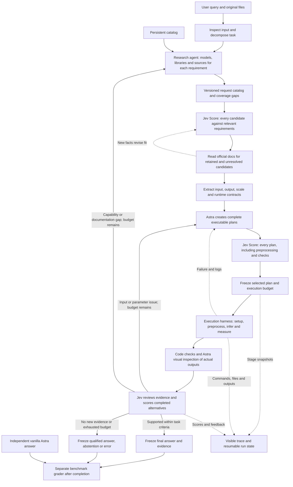

# Research, plan, execute and verify: the target harness

Status: architecture specification, 2026-09-22. This is the user's clarified target.
The connected implementation and actual file map are now in the
[v3 implementation guide](research-execution-v3.md). The updated API key is healthy. Development completed a measured, reviewed answer
and a recovery check; the held-out pilot is being launched, with no v3 score yet. Astra remains `gpt-6-astra`;
Jev remains a separate scoring/review provider. The proposed module names below
describe the original design; consult the implementation guide for actual paths
and explicitly bounded capabilities.

The system takes a user task, discovers suitable models and libraries, reads their
documentation, plans their use, prepares the correct inputs, executes and debugs
the workflow, inspects actual outputs, and returns evidence. A visible execution
harness supplies Astra with shell, files, Python environments, model workers and
the available operating-system tools. Jev supplies explicit decision checkpoints.

## What the previous experiments actually tested

| Component | Current repository | Target |
|---|---|---|
| Research | `routing/research.py`: separate command, up to six model proposals, citations and Jev relevance scores; advisory only. | Query-driven discovery connected to the run, covering models, libraries and every required task stage. |
| Candidate catalog | `catalog/microscopy-v1.json`: three StarDist parameter profiles and Cellpose-SAM. | A persistent catalog plus a versioned catalog assembled for this request. New discoveries can acquire validated executable adapters. |
| Candidate selection | v1 scores registered procedures before inference. | Score every discovered candidate against its applicable task requirements and record exclusions. |
| Documentation | Sources and descriptions exist; no mandatory documentation-to-input-contract stage. | Retrieve official usage/model docs; extract input, output, scale and runtime requirements before authoring executable plans. |
| Planning | Bounded typed plans/registered procedures. | Competing complete workflows, including setup, preprocessing, inference, postprocessing, checks and recovery. |
| Execution | Fixed workers in separate Python environments. | Astra operating an inspectable execution environment, with persistent task state and checkpoints. |
| Output selection | Experimental v2 runs up to four procedures, shows overlays to Astra, and scores observed candidates with Jev. | Evidence-driven selection and bounded repair, replanning or renewed research. |
| Review loop | Older OpenCV/StarDist runtime has a bounded loop; v2 explicitly disallows it. | One connected loop carrying failed checks and new evidence into research, selection and planning. |
| Evaluation | Saved native runs, separate graders and Harbor trajectory exports; earlier experiments also used Harbor jobs. | Benchmark the entire declared workflow with protected grading data and complete cost/trace accounting. |

The corrected 58.6% result belongs to the old v1 pipeline. It says nothing directly
about the performance of this proposed architecture. The 37 Kromp images have now
been examined for debugging; use them as development/audit data rather than calling
another tuned run a new held-out test. See the [reference/scale audit](../reports/stardist-audit-20260922/index.html).

## End-to-end flow

An initial probe may decode the file and measure dimensions/range before research.
**Model-specific preprocessing executes after documentation and plan scoring.** It
is a scored part of the plan, not an invisible conversion performed beforehand.

## 1. Turn the query into a task contract

For “count microscopic nuclei,” record what constitutes a nucleus, treatment of
border objects, whether the input is 2D or a volume, expected output and any user
constraints. Inspect file type, array shape, bit depth, channels, metadata and
available hardware. Keep observed properties separate from Astra's interpretation:
a grayscale array alone does not establish fluorescence or a specific stain.

Represent dependencies explicitly. Reading an image, segmenting nuclei, separating
instances, counting, checking boundaries and displaying evidence are different
requirements. A task may need a library for one step and a neural model for another.
Unknown acquisition metadata remains unknown; do not invent microns-per-pixel.

Save `task.json`, `input-probe.json` and original-file hashes. Keep full-resolution
scientific data intact; rendered previews are separate artifacts for visual input.

## 2. Research a catalog for this request

The research agent searches author-maintained documentation, model cards, papers,
repositories and the existing local catalog. Each candidate must answer:

| Field | Meaning |
|---|---|
| `candidate_id`, `kind` | Stable ID; model, conventional algorithm, library or execution service. |
| `requirement_ids` | Exactly which parts of the user task it can serve. |
| `capability`, `limitations` | What it does and what it cannot establish. |
| `version`, `checkpoint`, `license` | Concrete implementation/weights and usage constraints; distinguish unknown from verified. |
| `input_contract`, `output_contract` | Shapes, axes, channels, value ranges, units and output semantics. |
| `runtime_requirements` | Dependencies, platform/device support and documented memory requirements. |
| `evidence` | Source URL, section, retrieval date, content hash, supported claim and unresolved questions. |
| `integration_status` | Discovered, documented, runnable, smoke-checked, evaluated or unavailable. |

For microscopy, the request catalog can contain a TIFF reader, normalization
utilities, StarDist, Cellpose, morphology operations and visualization libraries.
These are complementary roles. A file reader should not lose a global popularity
contest against a segmentation model when both are needed.

“All candidates” means every candidate in the recorded discovery set, not a claim
to have exhausted the internet. Save search queries, source coverage, duplicate
merges, discovery limits and uncovered requirements. Score candidates in batches
as needed. Do not silently keep the old six-proposal limit or discard entries to
fit a Jev request. A budget-limited search reports incomplete coverage.

## 3. Jev scores candidate applicability

Use an initial source-backed candidate brief for the first scoring pass. For each
candidate and relevant requirement, ask separate questions about task fit, input
fit, evidence strength, output usefulness and deployment feasibility. Preserve the
full Score distribution and confidence. Use consistent rubrics for comparisons
within the same role. Jev's Score is an ordinal judgment, not predicted benchmark
accuracy. The provider documents that confidence describes concentration across
its scoring levels. [TypeSafe Score](https://docs.typesafe.ai/primitives/score)

The state includes the original task contract, measured input properties,
candidate facts with source excerpts, hardware constraints and unresolved facts.
Do not supply only Astra's recommendation, and withhold Astra's preferred ordering
from the scoring pass. Programmatic selection uses a versioned rule over these
scores, requirement coverage and the execution budget.

Record a decision for **every candidate**: retain, discard, investigate further,
or unavailable under current constraints. Score even an incompatible discovered
candidate for trace completeness, but its score cannot override a proven input or
runtime incompatibility. If scoring fails, record that failure; do not fabricate a
score or call a partial ranking complete. A low score caused by missing evidence
can trigger more research rather than permanent rejection.

Choose a set that covers all required steps. Do not select just the globally
highest-scoring model and forget file loading, counting or verification. Keep
complementary candidates and a bounded number of useful alternatives.

## 4. Read the selected models' documentation deeply

Retrieve the relevant installation guide, model card, inference API, preprocessing
requirements, output definitions, scaling/tiling guidance and known failure modes.
Preserve retrieved documents and source locations; mere URL presence is not proof
that a claim is supported. Conflicting docs or version differences remain explicit.

Build an evidence-linked usage contract before Astra writes the executable plan.
Required fields cannot be waved through as “probably fine.” Include candidates
with unresolved fit when further documentation could change their ranking. If the
deep read changes applicability, update the candidate record and rerun selection.

StarDist illustrates why this stage matters: its documentation discusses channel
requirements, normalization and object size in pixels, and exposes an inference
`scale` parameter. Those requirements must reach the planner. A plan saying only
“use StarDist” is incomplete. [StarDist FAQ](https://stardist.net/faq/)

## 5. Astra authors workflows; Jev scores all of them

A plan is a graph of concrete operations with dependencies, not a model name plus
a rationale. Each step declares input artifacts, expected outputs, a usage-contract
reference, parameters, runtime requirements, checks and recovery behavior.

For a nuclei-counting plan, specify the source channel, dtype, normalization axes
and percentiles, whether scale changes, tiling/overlap handling, exact checkpoint,
instance interpretation, border rules, count derivation and visualization. A scale
estimate must come from supplied metadata, input observations or a previously
validated estimator—not the hidden reference masks.

Jev scores every proposed complete plan for documented use, coverage of the user
request, correctness of transformations, observable verification and feasibility.
The runtime rejects structurally invalid plans regardless of their score. Retain
plan scores separately from candidate-model scores; the best model can appear in
a bad plan, and a modest model can be used correctly.

Candidate workflows may compare scales or models. Their selection rule and number
of allowed attempts must be declared before their outputs are inspected. Do not
retrospectively pick the closest result using benchmark labels. Changed parameters
produce a new plan version and another scored decision, rather than an undocumented
patch inside the execution agent.

## 6. Give Astra a real, visible execution environment

Use a detachable Codex backend for local agent execution rather than assuming a
bare model API has a shell. The official Python Codex SDK controls the local
app-server and supports threads; the app-server exposes command and file events.
This is an integration candidate, not something installed by this design change.
[Codex SDK](https://learn.chatgpt.com/docs/codex-sdk)
[App Server](https://learn.chatgpt.com/docs/app-server)

The controller owns the Jev stage transitions. Use distinct task-scoped planning
and execution turns: planning produces scored plan artifacts; an execution turn
receives the frozen plan and allowed work. An open shell plus a prompt saying
“please obey Jev” is not an enforceable stage boundary. The integration must check
that the executor cannot silently start unrelated models or change the method
without returning a revised plan to the controller. If that cannot be enforced,
label the configuration advisory instead of claiming mandatory Jev gating.

The execution backend can inspect files, author adapter code, create isolated
Python environments, install dependencies, fetch selected weights, run inference,
read logs, visualize masks and make bounded repairs. On macOS, Homebrew is one
possible system-dependency tool. Native OS capabilities require their actual tool
integration and permissions; an API key alone does not provide every macOS ability.
Preserve existing authorization and host permission controls. Package installation
is a logged operation within the run, not an assumption hidden from latency.

Do not retain v1's permanent requirement that every discovery needs a manually
registered adapter. Astra can author a provisional adapter from the documented
contract, subject to executable input/output checks and a recorded smoke test.
Passing that test makes it runnable, not scientifically validated. Ordinary unit
fixtures can test shape/coordinate handling; they are not substitutes for the real
benchmark images requested for capability evaluation.

Each specialist runs in a suitable environment with pinned dependencies and a
checkpoint hash. A worker should receive its inputs and needed configuration, not
the controller's API keys. Keep raw data separate from display images, and preserve
coordinate transforms, array axes and physical units. CPU, Apple MPS and CUDA
support must be verified per implementation; remote compute is an explicit backend
when required. The controller, Jev and specialist workers need not share one box.

Persist run IDs, stage checkpoints, task state, provider exchanges, commands,
stdout/stderr, exit status, code/environment hashes, output artifacts and usage.
Resume successful steps using their complete input/configuration hashes. Never
reuse a previous repetition's prediction and describe it as a fresh inference.

## 7. Consolidate evidence without asking Astra to invent measurements

Tool adapters return a typed evidence bundle: original/transformed input hashes,
model and environment versions, parameters, output array/mask paths, coordinates,
units, instance records, derived counts, quality checks, images and limitations.
Large arrays and images stay in artifact storage; state contains references and
relevant numerical summaries. Real image inputs go to a vision-capable model.

Code derives numerical measurements from validated outputs. Astra interprets and
explains them, with explicit provenance. A count cannot silently change while
being rewritten into prose. Handle merged labels, fragments and tile duplicates
according to the adapter's documented output semantics. A nonempty mask or a
matching count alone is not evidence of correct segmentation.

Jev currently accepts text/structured state, not image input. JSON containing RGB
values or a base64 image does not give it a trained visual perception interface.
It can assess source requirements, measurements, checks, disagreement and attributed
visual observations from Astra. It cannot independently certify unseen nuclei from
those summaries. A separate visual critic is an optional component to test, not a
guarantee. [TypeSafe state documentation](https://docs.typesafe.ai/concepts/state)

## 8. Review can return to research or planning

After execution, run checks for geometry, transforms, output schema, count/mask
consistency and candidate disagreement. Astra inspects original images, overlays
and relevant crops. Jev scores completed alternatives and evaluates explicit
evidence-support questions. Use both observations and measurable checks; model
agreement can share a systematic error.

Feedback names the failed requirement, affected artifacts, supporting observation
and next evidence needed. Carry it into candidate scores and the next plan score.
Examples: confirm a channel, inspect whether one nucleus is split, test a documented
scale alternative, repair tiling, or research a model for an unsupported modality.

Stop on satisfied checks, lack of new useful evidence, exhausted time/call/compute
budget, or an unrecoverable condition. Do not loop until Jev eventually gives a high
number. Keep these outcomes distinct: answer, qualified answer, abstention,
unsupported input, provider error and execution error. A timeout is not rejection.
No benchmark labels or grader rewards enter this loop during a test trial.

## 9. Evaluate the whole system against vanilla Astra

The primary comparison requested by the user is the complete workflow versus
vanilla Astra on the same prompt and image, with the same exact Astra model and
recorded reasoning/output settings. Vanilla receives no specialist results,
catalog, documentation research or Jev feedback. Run it independently and never
expose its benchmark outcome to the harness. Unlike the experimental v2 design,
the primary vanilla answer is not automatically inserted as a routing candidate.
If the harness makes its own visual estimate, count that as harness work.

| Arm | What it establishes |
|---|---|
| Vanilla Astra | Direct multimodal baseline; primary comparator. |
| Astra/Codex with equal tools, research access and budget, without Jev | Whether Jev's intervention improves on a capable execution agent. |
| Full research → candidate scoring → docs → plan scoring → execution → review workflow | Performance of the system described here. |
| Strong fixed specialist, chosen on development data | Whether orchestration adds value beyond a simple specialist pipeline. |

This second control is useful because vanilla-versus-full alone cannot attribute
gains specifically to Jev rather than tools, research or additional computation.
Primary end-to-end measurements include setup, research, retries and failures.
Also report warm-environment execution separately, plus a matched-budget comparison
where appropriate. A single-call baseline and a long agent run are different
resource regimes; show their cost and latency rather than concealing the difference.

Use multiple fresh runs of a predeclared external cohort. Report counts returned,
all-attempt success within tolerance, conditional count error, segmentation quality
where masks exist, wall time, hosted usage, local/remote compute and failure types.
Average errors after scoring each run. Confidence intervals should resample images
or patients as appropriate, not treat repeated calls as independent specimens.

**Keep the grader physically outside the agent-visible environment.** Shell access
changes the threat model: placing labels elsewhere in a readable repository is not
isolation. Mount only task inputs and permitted resources into the agent sandbox;
keep reference masks, answers, previous score reports and verifier credentials in
a separate verifier environment. Validate original references before unsealing a
benchmark; flag reused IDs instead of silently treating every fragment as a nucleus.

Permit model-documentation research under a declared network/retrieval policy.
Avoid exposing benchmark filenames, IDs and answer pages to discovery; preserve
retrieved content and flag accidental solution exposure. Public benchmark exposure
in pretrained models remains a limitation. Snapshot generic research and a catalog
for a controlled comparison, and separately measure unrestricted live discovery if
that is the intended product setting. Label these conditions separately.

Harbor runs/traces the declared evaluation integration; Jev is not the benchmark
grader. Prefer an installed-agent integration when the agent runs inside the task
environment; an external integration must act through the environment interface.
Native macOS/MPS execution needs a declared compatible environment; exporting an
ATIF trace alone is not the same as running a Harbor-isolated job.
[Harbor custom agents](https://docs.harborframework.com/core-concepts/agents/custom-agents)

## Proposed modular implementation map

All paths below are proposed under `src/vision_harness/research_execution/` unless
otherwise shown. Existing v1/v2 modules remain available for reproducing old runs.

| File | Owns | Does not own |
|---|---|---|
| `contracts.py` | Task requirements, candidates, usage contracts, plans, evidence and outcomes. | Provider-specific HTTP. |
| `intake.py` | Input facts, original-file hashes and task decomposition. | Model-specific transformations. |
| `discovery.py` | Search jobs, candidate extraction, deduplication and requirement coverage. | Installation or selection. |
| `documents.py` | Source retrieval, version snapshots, usage-contract extraction and claim references. | Assuming a citation proves a claim. |
| `catalog.py` | Persistent entries and immutable per-run catalog versions. | Executing arbitrary discovered code. |
| `scoring.py` | Jev candidate/plan/output scoring, batching, completeness and raw score records. | Mutating measurements or grading hidden labels. |
| `selection.py` | Versioned decisions from scores, coverage, compatibility and budgets. | Claiming scores are accuracy probabilities. |
| `planner.py` | Astra plan proposals and revisions incorporating usage contracts and review history. | Executing its unscored plan. |
| `execution.py` | Backend interface, frozen-plan jobs, cancellation, checkpoints and result collection. | Choosing a new scientific method silently. |
| `backends/codex.py` | Codex SDK/app-server session and visible tool-event integration. | The model-independent selection policy. |
| `environments.py` | Dependency/checkpoint setup, device inventory and reproducible environments. | Inferring CUDA support from MPS availability. |
| `adapters.py` | Existing or generated adapter contracts, smoke checks, input transformations and inference. | Transforming display previews into the sole scientific data source. |
| `evidence.py` | Artifact manifests, coordinates, measurements, mask checks and visual packets. | Rewriting model output to improve a score. |
| `review.py` | Review state, targeted feedback, novelty checks and bounded continuation. | Access to benchmark answers. |
| `runtime.py` | Durable state machine connecting all these stages and terminal outcomes. | Reimplementing library inference. |
| `cli.py` | Visible stage progress, inspection and resume controls. | Hiding retries or failed candidates. |
| `evals/research_execution/` | Cohort freeze, protected Harbor integration, independent grading and reports. | Supplying labels to the live harness. |

Reuse the existing provider wrappers, artifact conventions, workers, trace exporter
and annotation-integrity checks where their contracts fit. Reuse does not mean
claiming current capability is broader than it is: today research only admits
model proposals, and the current workers do not execute newly discovered adapters.

## Implementation and acceptance order

1. Define task/candidate/usage/plan contracts and the durable stage transitions.
   Test that every candidate and plan receives an explicit scoring outcome.
2. Connect discovery and document retrieval to those contracts. A microscopy task
   must produce requirements, candidate roles and source-backed usage constraints.
3. Add the Codex execution backend, isolated environment setup and adapter checks.
   Verify that execution uses the scored plan and any method change returns for
   scoring. Confirm `gpt-6-astra` is supported by the actual configured backend;
   report lack of access instead of silently substituting another model.
4. Add structured outputs, visual evidence, Jev review and bounded replanning.
   Carry actual failed checks into later decisions and preserve every attempt.
5. Run a development integration trial that exercises research through final
   evidence, including one recoverable failure. This is plumbing verification.
6. Freeze policy, prompts, environments, budgets and reference handling. Run the
   complete system and controls on new external tasks over multiple fresh runs.
   Produce final all-attempt results; do not substitute best intermediate answers.

The next accuracy number called “the full harness” must identify this workflow,
its enabled stages, execution budget and evaluated cohort. Until then its score
is **not yet measured**.
