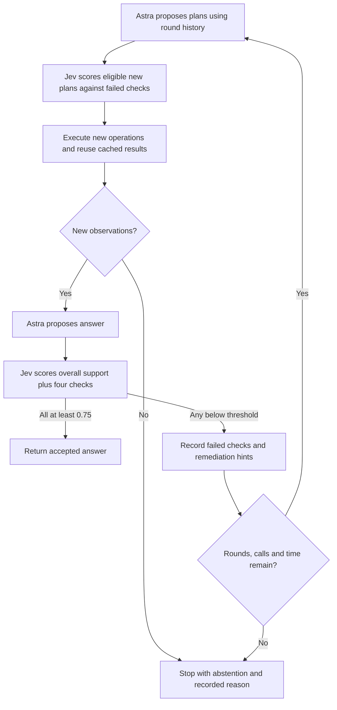

# Structured review and bounded replanning

The optional loop gives both Astra planning and Jev selection the previous plans, measurements, candidate answers and review checks. Enable it with `--config configs/poc-loop.toml`. The original `configs/poc.toml` remains the legacy two-round configuration.



## What the reviewer returns

One request contains the existing overall support question plus four Noul questions:

| Check | What must be supported | What a failed check asks the next plan to address |
|---|---|---|
| Method validity | The method's assumptions fit the actual input. | Change the effective method or measure the missing applicability condition. |
| Coverage | Evidence covers the requested scope without omissions or double counting. | Account for missing regions, crop overlap, borders and extrapolation. |
| Target validity | Measured regions or points reasonably correspond to the requested targets. | Investigate merging, fragmentation or endpoint identity. |
| Answer grounding | The answer follows from cited measurements and justified operations. | Supply a measured derivation and justify adjustments. |

The response includes each numeric score. Failed-check IDs and remediation hints are constructed deterministically from the configured rubric. They are not free-form explanations attributed to Jev. The harness requires all four checks **and** overall support to meet 0.75. These are experimental evidence-support thresholds, not calibrated probabilities of correct cell counts. Adding these checks makes acceptance stricter than the old scalar-only gate; this experiment tests the combined policy, not feedback alone.

Jev receives structured state; it does not inspect image pixels through artifact IDs. This API supports a map of typed questions over one state: [TypeSafe API reference](https://docs.typesafe.ai/api). Astra still receives actual image inputs. No new vision model or segmentation algorithm is introduced in this experiment.

## What goes around the loop

Both the next planner and selector receive `round_history` and `feedback`, including previous candidate plans, selections, Jev assessments, evidence IDs, proposed counts, and review scores. Full measurements are supplied through the evidence collection. A prior score is not evidence that a count is correct or incorrect.

The selector's instructions explicitly ask whether a candidate can address an unresolved check with additional measurements. Python separately rejects candidates whose effective operations have all been attempted. It also reuses existing outputs when a new plan shares an operation with an earlier plan. Operation identities ignore plan/step names and the currently ignored `value_min` parameter in OpenCV's `color="any"` branch. This reflects the existing tool behavior; it does not change that behavior.

After execution, the controller compares measurement contents and image hashes/coordinates against earlier observations. Renaming evidence or changing parameters without changing observations does not justify another answer/review cycle. A different crop counts as a new observation but is not automatically valid counting evidence; the reviewer must still assess coverage and grounding. This detects exact repetition, not all scientifically uninformative changes.

## Limits and stopping

- At most four planning rounds, three candidates per round and three steps per candidate; selection executes at most two plans.
- At most 24 provider requests, counting Astra format retries.
- No new provider request or tool operation starts after 600 seconds. An already-running request may finish after that deadline, subject to its own timeout.
- Stop after one executed round with no new observations; also stop if no eligible new plan is selected, Astra abstains, or frozen plans prevent further replanning.
- Overall support and each check must all pass. Reaching a budget produces an abstention, not an accepted old candidate.

The Jev serialized request budget is 48,000 bytes for this experiment to accommodate the added history. Component geometry can be summarized as before; exact full requests remain in local trace artifacts. The budget is not a token estimate. If evidence cannot fit, the request fails explicitly rather than silently deleting the rubric or changing scores.

## Run and inspect

```sh
uv run vision run --image path/to/image.png --prompt "Count the cells" --mode full --config configs/poc-loop.toml
uv run vision replay runs/RUN_ID
```

`loop-history.json` holds the round records. `events.jsonl` includes `review_feedback`, `tool_reused`, `loop_round` and `loop_stopped`; these events also appear in exported Harbor trajectories. All candidate counts remain visible even if their final reviews fail.

The published-microscopy retest uses `configs/bbbc001-loop.toml`. It compares vanilla against this complete loop on the same six BBBC001 images, with fresh task snapshots and one attempt per mode. This is previously inspected data, not a new held-out test. The baseline remains necessary because earlier single-run vanilla error varied. These exploratory results cannot establish a stable ranking across all harness variants.
