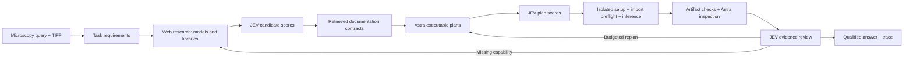

# Team handoff

## What is implemented

The long-term goal is a general-purpose specialist-model harness. The current
connected implementation is a microscopy application of that architecture:
**2D fluorescence nucleus counting**, using original TIFF inputs and instance
masks. General visual reasoning, DICOM/fMRI, video and audio are not implemented
or validated by the microscopy results.

The older OpenCV CLI has basic image operations, but that does not make the new
research/execution pipeline domain-independent. Its task schema, controller
instructions, artifact validation and benchmark grader still assume nuclei.



JEV receives structured evidence and attributed visual observations; it is not
an independent pixel-level judge in this implementation. A provisional count is
not a JEV-approved answer.

## Start reviewing here

| Area | Files | Current responsibility |
|---|---|---|
| Controller | `src/vision_harness/research_execution/runtime.py` | Stage ordering, bounded research/replanning, feedback, final-answer preservation. |
| Contracts | `research_execution/contracts.py` | Structured task, catalog, usage, executable plan and outcome schemas. `Task.task_type` currently permits only `nucleus_counting`. |
| Research and docs | `research_execution/discovery.py`, `documents.py` | Source-backed discovery, usage retrieval and bounded contract correction. |
| Decisions | `research_execution/scoring.py` | Candidate/requirement scores, plan scores, output scores and review through JEV. |
| Plans and execution | `research_execution/planning.py`, `preflight.py`, `executor.py` | Validate proposed code/dependencies, freeze selected program, run via Codex and check handoff. |
| Evidence | `research_execution/evidence.py` | Probe microscopy inputs, check masks/counts, make visual evidence. |
| Providers | `src/vision_harness/providers/` | Astra/JEV adapters, bounded transport retry and evidence request sizing. |
| Domain instructions | `prompts/astra-research-execution.md` | Current scientific input, output and provenance requirements. |
| Evaluation | `evals/research_execution/` | Frozen cohorts, isolated Harbor runs, hidden reference grading and reports. |
| Deployment | `infra/daytona/reuse/` | Serial trials in one registered GPU workspace with separate writable trial directories. |

Paths abbreviated as `research_execution/…` are under
`src/vision_harness/`. See [the full file map](file-map.md) and
[operational fixes](operational-repair-20260924.md).

## What to separate for general-purpose use

This is a proposed refactor, **not an already implemented plugin API**:

| Shared controller should own | A domain adapter should own |
|---|---|
| Research, source provenance, candidate ranking | Task types and task decomposition requirements |
| Documentation contracts and bounded planning | Input readers, axes, units, metadata and preprocessing constraints |
| Scored executable plans and dependency setup | Supported output artifacts and validity checks |
| Isolated execution, budgets, retries and traces | Model-specific invocation compatibility and checkpoint information |
| Review feedback and replanning lifecycle | Evidence rendering and review criteria |
| Evaluation scheduling and result accounting | Datasets, reference handling and accuracy metrics |

The first migration should preserve microscopy as one adapter and its existing
regression tests. A second, non-microscopy task can then test whether that boundary
is useful. Simply changing the accepted task-type string would leave the nucleus
prompts, mask contract and grader in place and would not generalize the system.

## Local onboarding

From the repository root, with Python 3.12 and uv installed:

```sh
uv sync --extra eval --extra research
cp .env.example .env  # New checkout only; preserve an existing local .env.
uv run pytest -q tests infra/daytona/reuse/test_environment.py infra/daytona/reuse/test_auth_guard.py
uv run ruff check src evals tests infra/daytona
uv run python -m vision_harness.research_execution.cli --help
```

Fill credentials locally. Tests use mocks/fixtures and do not run a paid cohort.
For optional Daytona management, create its separate pinned environment:

```sh
uv venv runs/daytona/venv --python 3.12
uv pip sync --python runs/daytona/venv/bin/python infra/daytona/control.lock
runs/daytona/venv/bin/python -m unittest infra.daytona.test_resource_limits -q
```

Add `DAYTONA_API_KEY` to your local `.env` only if you need cloud management.
These resource-limit tests use mocks and create no cloud resources.
The research CLI's full scientific execution requires its isolated Linux task
runtime; do not run generated scientific code directly on a teammate's host.
See [the v3 guide](research-execution-v3.md) for the Docker evaluation workflow.

Model weights, `.env`, generated datasets, raw `runs/` and `jobs/`, and local
Daytona ownership registration are excluded from Git. A clone contains code,
prompts, lockfiles, documentation and selected reports—not the live cloud state.
A teammate must coordinate access to the existing workspace with its owner;
provisioning another workspace is not part of onboarding. Existing resource
ownership checks intentionally reject unregistered resources.

The reusable benchmark's `common.py` and `prepare.py` describe a **specific frozen
historical experiment**. Its preparation depends on excluded task/control files
and checks the original source fingerprint. It is not a generic launch command
for arbitrary new code. Keep existing experiment directories immutable; declare
a new experiment identity and freeze current code/inputs for a future cohort.

## Most recent measured result

See [the completed GPU benchmark summary](../reports/research-execution-20260922/test-gpu-repair02/summary.md).
It predates the latest operational fixes. Those fixes passed regression checks
and targeted live replays; a complete benchmark of the repaired revision has
not been run. Historical reports describe their frozen versions, not necessarily
current development behavior.
