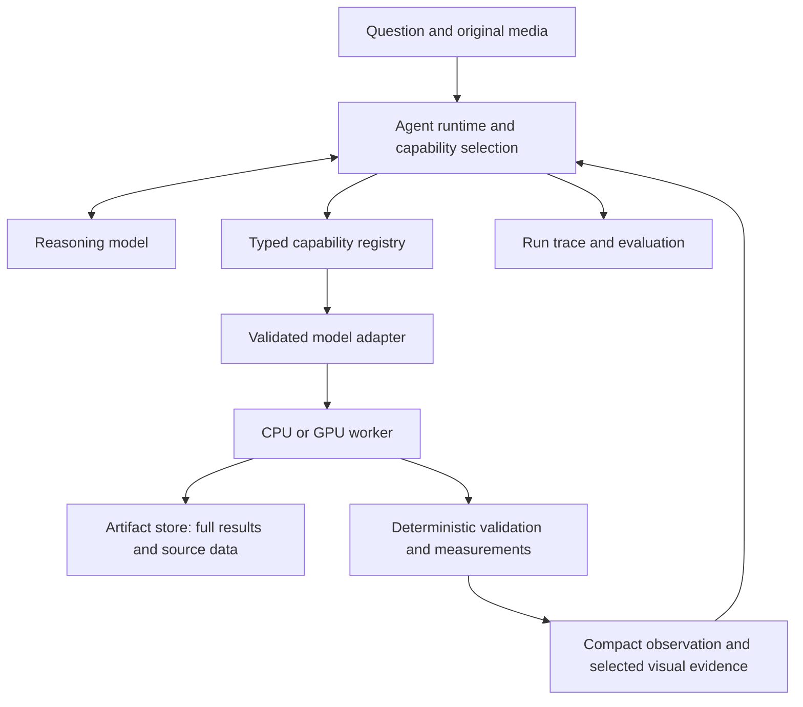

# Open-source harnesses to study for a specialist-model coordinator

Research checked September 18, 2026. This is a reading guide and design recommendation, not an implementation or a performance evaluation. The order reflects relevance to this project, not a benchmark ranking.

The most useful pair to read first is DeepSeek Harness for modular architecture and smolagents for a compact Python implementation. Use the accompanying [specialist-model landscape](specialist-model-landscape-2026-09-18.md) to choose capabilities independently of the runtime.

| Priority | Project and license | What to study | Fit for this project |
|---|---|---|---|
| 1 | [DeepSeek Harness](https://github.com/deepseek-ai/deepseek-harness), MIT | Replaceable plugins, tool contracts, session events and background jobs | Particularly relevant architectural reference. It is a developer preview; treat APIs as changeable. |
| 2 | [Hugging Face smolagents](https://github.com/huggingface/smolagents), Apache 2.0 | Python agent loop, tools, programmatic composition and model adapters | My first choice for understanding a small prototype close to the Python ML ecosystem. Supports code-executing and conventional tool-calling agents. |
| 3 | [LangChain Deep Agents](https://github.com/langchain-ai/deepagents), MIT | Filesystem-backed context, middleware, subagents and persistence through LangGraph | Useful if long workflows and resumability become requirements; more abstractions to learn. |
| 4 | [Pi](https://github.com/earendil-works/pi), MIT | Separation of provider API, agent runtime and coding-agent application | Good TypeScript reference for boundaries between components. The older badlogic/pi-mono URL redirects here. |
| 5 | [OpenHands Software Agent SDK](https://github.com/OpenHands/software-agent-sdk), MIT | Conversation, tool and workspace boundaries; remote Agent Server | Useful for isolated execution and remote workspaces. Its main application is software development, so perception adapters remain your work. |
| Evaluation companion | [Harbor](https://github.com/harbor-framework/harbor), Apache 2.0 | Benchmarks, environments, agent adapters and scored trials | Use it to evaluate competing harness designs. It does not supply your specialist-model inference layer. |

Each project link is its primary repository and supports the features/license in that row. Selection and suitability judgments are mine. OpenHands refers specifically to the linked SDK, not every product in its ecosystem. Licenses for model weights and external services remain separate from harness licenses.

**DeepSeek reading sequence.** Start with its [official introduction](https://deepseek.com/harness/en/) and [architecture](https://github.com/deepseek-ai/deepseek-harness/blob/master/docs/architecture.md). The Cordis plugin system separates model providers, tools, the agent loop and session storage. The session log reconstructs model-visible context. Then read [tool authoring](https://github.com/deepseek-ai/deepseek-harness/blob/master/docs/cookbook/adding-a-tool.md) and, only for implementation detail, the [tool subsystem](https://github.com/deepseek-ai/deepseek-harness/blob/master/docs/subsystems/tools.md).

The tool contract is especially relevant to your earlier output-consolidation question: execution returns a schema-checked canonical JSON value; a renderer produces model-facing content; UI presentation is separate. Canonical values are not automatically a durable archive of scientific output. Large arrays and complete results need your own persistent artifact storage. These are documented framework behaviors, not evidence that a specialist pipeline improves accuracy.

For smolagents, trace [agents.py](https://github.com/huggingface/smolagents/blob/main/src/smolagents/agents.py), then [tools.py](https://github.com/huggingface/smolagents/blob/main/src/smolagents/tools.py). Find where a model proposes an action, where arguments are passed to a tool, where its result enters the next model turn, and how errors terminate or change the loop. The [official documentation](https://huggingface.co/docs/smolagents/index) provides the higher-level introduction. You do not need to understand every provider or deployment option first.

Two specialist projects provide concrete adapter precedents. [TotalSegmentator](https://github.com/wasserth/TotalSegmentator) documents a JSON capability registry, structured run manifests, segmentation statistics and an [MCP server](https://github.com/wasserth/TotalSegmentator/blob/master/totalsegmentator_mcp/README.md). [PyOD](https://github.com/yzhao062/pyod) documents agent-driven anomaly investigations and MCP tools for discovery, planning, detection and analysis. Read these to see how actual scientific and business computations become callable capabilities. Neither establishes that every possible LLM workflow will improve.

**How I would adapt those ideas.** The following is a proposed design, not a feature claim about any one repository:

The reasoning model selects an operation and interprets its evidence. The adapter validates inputs, performs preprocessing and calls the specialist. Numerical code turns predictions into counts, measurements or other defined outputs. The LLM should not be the component that reconstructs coordinates or turns prose into the authoritative measurement table.

Expose capabilities such as `detect_objects`, `read_document`, `segment_region`, `estimate_depth`, `transcribe_audio` and `forecast_series`. Keep the underlying model/version selectable behind the adapter. Some capabilities have different semantics: relative depth and calibrated metric depth should have different contracts, even if both produce depth maps.

Each registered capability should record:

- Input/output schema, accepted modalities and unsupported inputs.
- Exact checkpoint identifier, code version, preprocessing version and license reference.
- Runtime requirements, estimated latency, batching support and concurrency limit.
- Output coordinate frame, units, timestamps and relevant transformations.
- Task-specific validation evidence and known failure modes.

Each observation should preserve a source artifact reference, result artifact references, producing model/version, parameters, measurement definitions, quality flags and relevant score semantics. A detector score is not automatically a calibrated probability; a model that does not produce uncertainty should not acquire an invented confidence number from the adapter.

For example, an object detector might produce boxes in original-image pixels and scores. A segmentation worker adds masks associated with those object IDs. Deterministic code computes pixel areas. The coordinator receives the count, selected boxes, quality flags and an overlay, while the full masks remain available by artifact ID. Physical area additionally requires valid image calibration. A follow-up crop or rerun records its transformation back to the original image.

**Separate orchestration from inference hosting.** A harness schedules and interprets operations; a worker loads and runs a model. For an initial experiment, those can be two processes on one machine. They can later live on separate CPU and GPU machines without changing the capability contract. A TypeScript coordinator can call Python workers over a local service boundary. MCP is an optional exposure protocol, not a requirement for GPU execution or a replacement for a job queue.

Do not load the entire model catalog into memory or expose every tool description in every prompt. Start with a small task-appropriate set; load or route other capabilities when needed. Profile the exact checkpoint, precision, image/volume size and batch size before choosing hardware. Multi-model residency and long video or 3D volumes can dominate memory requirements.

**A practical reading exercise before coding.** Follow one imagined request—“count these products, then flag damaged packaging”—through each candidate runtime. Identify where the source image lives, how detection is requested, how coordinates survive a crop, how a defect model receives regions, what happens when a worker fails, and which evidence the final answer cites. A repository that makes these boundaries understandable is a better starting point than one with the longest feature list.

Then choose one runtime and one task. Compare the same reasoning model alone, a fixed specialist pipeline, and adaptive tool use. Score task accuracy, unsupported conclusions, latency, cost and failed calls. The harness adds value only if this comparison shows an improvement relevant to the intended workflow.
